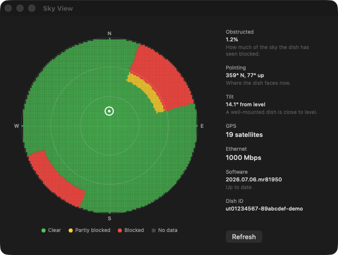

# UltraLink


A macOS menu bar app for Starlink users. See traffic, outages and obstructions without opening the router app. It reads the dish locally and never changes its settings.

<p align="center">
  
  &nbsp;
  
</p>

## Install and first use

On **macOS 13 or later**, [download UltraLink 0.1.1](https://github.com/michael-berardi/ultralink/releases/download/v0.1.1/UltraLink-0.1.1-mac.dmg), open the DMG and drag UltraLink to Applications. The download is signed and notarized, for Apple silicon and Intel. [Releases and checksums](https://github.com/michael-berardi/ultralink/releases/latest).

Open UltraLink while connected to your Starlink network, then click its menu bar icon. In **Settings › Dish**, enter another address if needed and press Return. If your router is in bypass mode, your network must still provide a route to the dish. Without a dish, enable **Settings › Data › Demo mode**.

## What it shows

- Download and upload speed or latency in the menu bar, with an outage icon.
- Ping, packet loss, obstruction percentage, power, uptime and GPS lock.
- Charts for 15 minutes, one hour, one day and one week; hover for values.
- Today’s and this month’s estimated data use, plus dish-reported outages and alerts.
- Outage and recovery notifications, when permission is granted.
- Sky View: obstruction map, pointing direction, tilt, GPS, cable speed and firmware.
- A speed test using macOS’s `networkQuality` tool.

Data totals come from the dish’s recent history. UltraLink can recover up to about 15 minutes when it starts; longer gaps are not counted. Totals are not billing measurements.

## Network and privacy

The dish’s unofficial gRPC-web API is normally at `192.168.100.1:9201`. Firmware changes may affect compatibility. UltraLink tries the default route, then Wi-Fi and Ethernet interfaces, which can help when a VPN takes over the default route. This does not guarantee access through every VPN or router configuration.

Status is polled every two seconds when the popover is open or the menu bar shows speeds or latency, otherwise every six seconds. Failed polls use a five-second delay. History is refreshed every ten seconds with the popover open, otherwise every minute. Request time adds to these intervals.

History stays in the user’s Application Support directory under `UltraLink/history.json`. The app keeps per-minute readings for a week. Speed tests contact Apple’s servers; Sparkle update checks contact GitHub daily by default. Disable automatic checks in **Settings › Updates**. Dish readings are not uploaded by the app.

## Build from source

Requires Xcode or its command-line tools with Swift 5.9 or newer. [Sparkle](https://sparkle-project.org) is the only package dependency.

```sh
git clone https://github.com/michael-berardi/ultralink
cd ultralink
SIGN_ID=- scripts/build.sh
```

The script builds both architectures and creates an ad-hoc signed `dist/UltraLink.app`. Distribution signing and notarization are separate release steps.

For a compile-only check without packaging or signing:

```sh
swift build -j 4 -c release --arch arm64 --arch x86_64 -Xswiftc -Osize
tests/unit.sh
```

The standalone decoder tests need no dish or app launch. The optional end-to-end check, `tests/run.sh <dish.protoset>`, requires the built app, Python 3 with `protobuf`, and a descriptor set obtained through gRPC reflection (see [starlink-grpc-tools](https://github.com/sparky8512/starlink-grpc-tools)). It starts a local mock and runs the app’s probe.

The executable accepts `--probe [host] --port <port>` to print readings once (defaults: `192.168.100.1`, `9201`), and `--demo` for sample data. `--show-popover`, `--show-sky` and `--show-settings` open those views in ordinary windows.

## License

MIT. See [LICENSE](LICENSE). UltraLink is independent and is not affiliated with or endorsed by the dish manufacturer.

---

Part of [Pareto Cybernetics](https://paretocybernetics.com/projects/ultralink/): free, private, open-source tools for working with AI agents.
