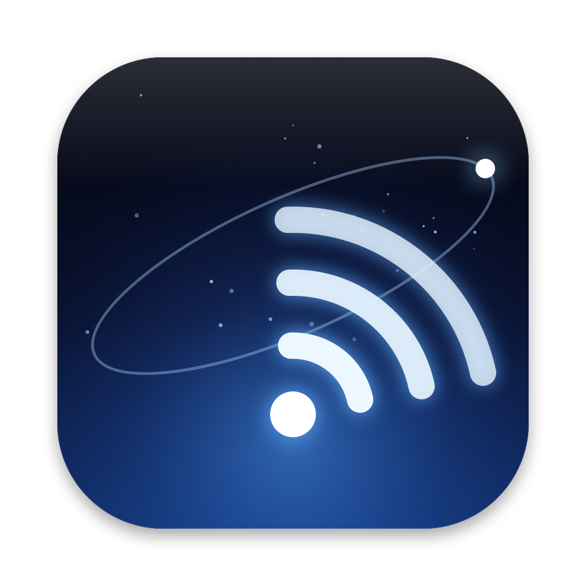
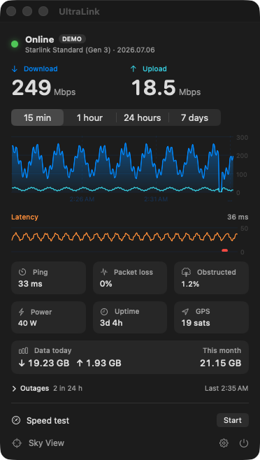
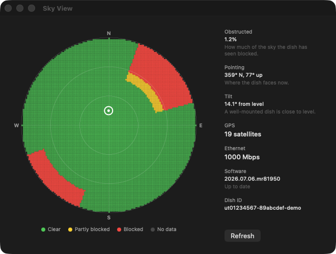

<p align="center">
  
</p>

<h1 align="center">UltraLink</h1>

<p align="center">
  Your Starlink connection, live in the Mac menu bar.<br>
  A tiny, free, open-source app. No account, no cloud, no tracking.
</p>

<p align="center">
  <a href="https://github.com/michael-berardi/ultralink/releases/latest">Download</a> ·
  <a href="#what-it-shows">What it shows</a> ·
  <a href="#build-from-source">Build from source</a>
</p>

<p align="center">
  
  &nbsp;
  
</p>

UltraLink is an independent project. It is not affiliated with or endorsed by SpaceX or Starlink.

## What it shows

- **Menu bar.** Live download and upload speed, or ping, next to a status icon. The icon changes during an outage.
- **Live numbers.** Download, upload, ping, packet loss, how much of the sky is blocked, power draw, uptime and GPS lock.
- **History.** Charts for the last 15 minutes, hour, day and week. Hover a chart to read any moment.
- **Data used.** Today and this month, counted while the app runs.
- **Outages and alerts.** The cause and length of each outage the dish reports, plus its own warnings (slow Ethernet cable, overheating, water detected, and more).
- **Notifications.** A message when the connection drops and when it returns.
- **Sky View.** The dish's obstruction map, where it points, its tilt, GPS, cable speed and software version.
- **Speed test.** One button, using the `networkQuality` tool that ships with macOS.

It is read-only. UltraLink never changes a setting on your dish or router.

## Install

**macOS 13 or later.** Download `UltraLink-<version>-mac.dmg` from [Releases](https://github.com/michael-berardi/ultralink/releases/latest), open it and drag UltraLink to Applications. The app is signed and notarized by Apple, about 5 MB, and checks for updates once a day (turn it off in Settings).

Your Mac has to be on the Starlink router's network: its Wi-Fi, or a cable to it. If the Mac is in bypass mode or you use a different address, set it in **Settings › Dish**. No dish nearby? **Settings › Demo mode** shows the app with sample data.

## Works with a VPN

A VPN or exit node (Tailscale, WireGuard and similar) takes over your Mac's default route, and the dish at `192.168.100.1` only exists on the Starlink router's own network. UltraLink sends its requests straight out of your Wi-Fi or Ethernet connection, so it keeps working with the VPN on.

## How it works

The dish serves a local API on your network (gRPC-web on port 9201). UltraLink asks it for status every two seconds while the menu is open or the menu bar shows speeds, and every six seconds otherwise, reads the dish's own 15-minute record every minute, and keeps per-minute averages for a week in `~/Library/Application Support/UltraLink/history.json`. It decodes the few fields it needs with a small built-in reader, so there are no dependencies except [Sparkle](https://sparkle-project.org) for updates.

The API is unofficial and Starlink can change it with a firmware update. Data totals only count time when UltraLink is running, because the dish keeps just 15 minutes of detail.

## Build from source

```sh
git clone https://github.com/michael-berardi/ultralink
cd ultralink
SIGN_ID=- scripts/build.sh      # ad-hoc signed build in dist/UltraLink.app
dist/UltraLink.app/Contents/MacOS/UltraLink --probe   # read the dish once and print what it says
```

- `--demo` runs with sample data. `--show-popover`, `--show-sky` and `--show-settings` open the views in ordinary windows.
- `tests/run.sh <dish.protoset>` starts a mock dish (`tests/mock_dish.py`) and checks the decoder end to end. A `dish.protoset` can be dumped from a dish's gRPC reflection with [starlink-grpc-tools](https://github.com/sparky8512/starlink-grpc-tools).

## Privacy

UltraLink talks only to your dish, on your local network. Nothing is sent anywhere else. The one exception is the speed test, which uses Apple's servers through `networkQuality`, and the daily update check against this repository.

## License

MIT. See [LICENSE](LICENSE).
