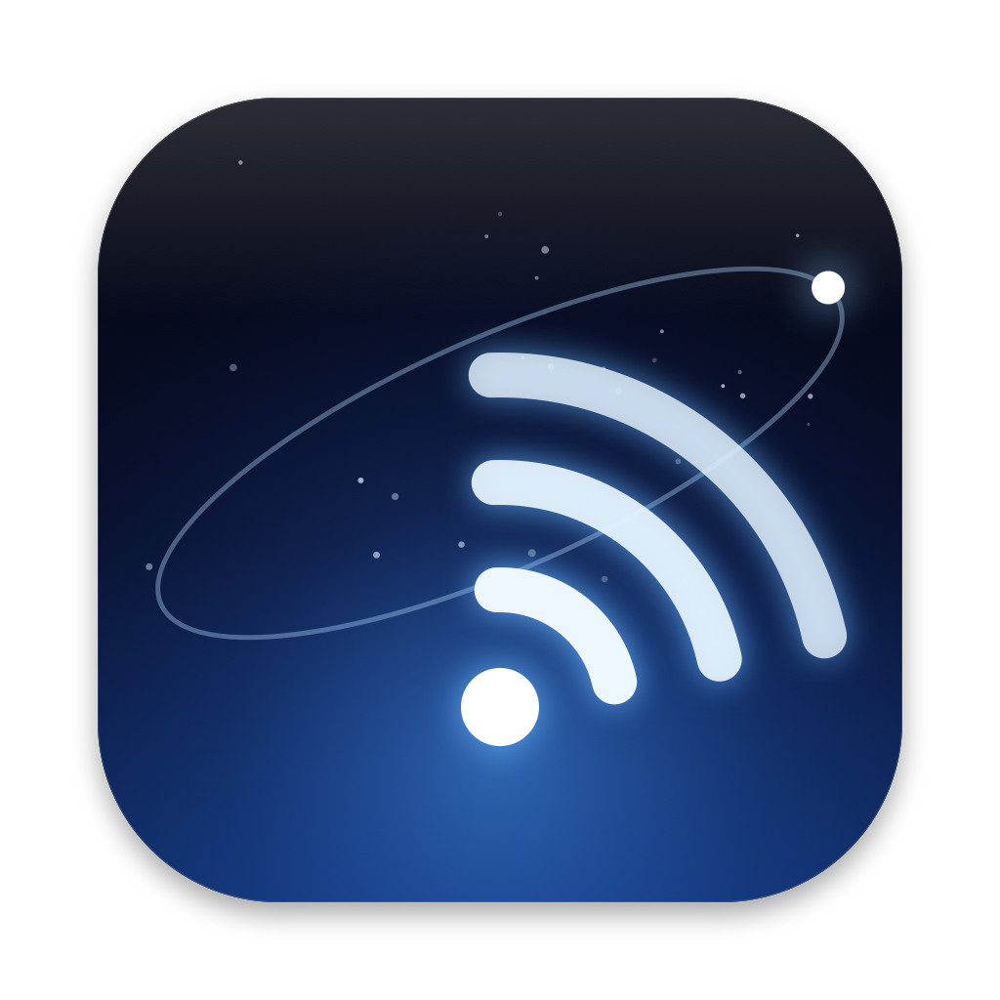
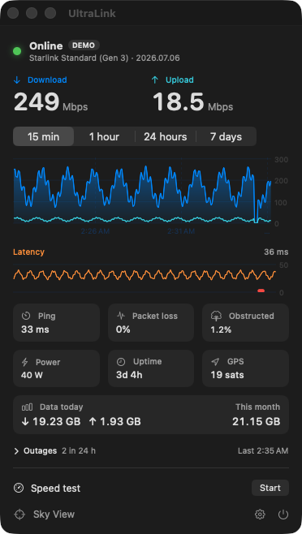

# UltraLink



A macOS menu bar app for Starlink users. See traffic, outages and obstructions without opening the router app. It reads the dish locally and never changes its settings.

<p align="center">
  
  &nbsp;
  
</p>

## Install and first use

On **macOS 13 or later**, [download the latest published UltraLink release](https://github.com/michael-berardi/ultralink/releases/latest), open the DMG and drag UltraLink to Applications. The download is signed and notarized, for Apple silicon and Intel. [Releases and checksums](https://github.com/michael-berardi/ultralink/releases/latest); the published download is [v0.3.0](https://github.com/michael-berardi/ultralink/releases/tag/v0.3.0). This branch is version 0.3.2 and is not published yet.

Open UltraLink while connected to your Starlink network, then click its menu bar icon. In **Settings › Dish**, enter another address if needed and press Return. If your router is in bypass mode, your network must still provide a route to the dish. Without a dish, enable **Settings › Data › Demo mode**.

## What it shows

- Download and upload speed or latency in the menu bar, with an outage icon.
- Ping, packet loss, obstruction percentage, power, uptime and GPS lock.
- Charts for 15 minutes, one hour, one day and one week; hover for values.
- Today’s and this month’s estimated data use, plus dish-reported outages and alerts.
- Outage and recovery notifications, when permission is granted.
- Sky View: obstruction map, pointing direction, tilt, GPS, cable speed and firmware.
- A speed test using macOS’s `networkQuality` tool.

Data totals come from the dish’s recent history. UltraLink can recover up to about 15 minutes when it starts; longer gaps are not counted. Totals are not billing measurements.

## Updates

UltraLink checks its signed release feed once a day. When a new version is out, a badge appears next to the menu bar icon; click **Update…** in the popover to install it, skip it or turn on automatic installs (off by default). Details: [docs/updates.md](docs/updates.md).

## Privacy

- No telemetry, analytics or account: dish readings stay on this Mac and its settings are never changed.
- The only automatic internet request is one anonymous daily update check; opt out in **Settings › Updates**.
- History (one week of per-minute readings) stays in a private folder; **Settings › Data › Erase History…** removes it, and stale leftovers are pruned automatically.
- The speed test contacts Apple only when you start it; an update downloads only after you choose Install or opt into automatic installation.
- Full details, including local paths and removal steps: [PRIVACY.md](PRIVACY.md).

## Build from source

Requires Xcode or its command-line tools with Swift 5.9 or newer. [Sparkle](https://sparkle-project.org) is the only package dependency.

```sh
git clone https://github.com/michael-berardi/ultralink
cd ultralink
SIGN_ID=- scripts/build.sh
```

The script builds both architectures and creates an ad-hoc signed `dist/UltraLink.app`. Distribution signing and notarization are separate release steps.

For a compile-only check without packaging or signing:

```sh
swift build -j 4 -c release --arch arm64 --arch x86_64 -Xswiftc -Osize
tests/unit.sh
```

The standalone decoder, update-rule and privacy tests need no dish, network or app launch. The optional end-to-end check, `tests/run.sh <dish.protoset>`, requires the built app, Python 3 with `protobuf`, and a descriptor set obtained through gRPC reflection (see [starlink-grpc-tools](https://github.com/sparky8512/starlink-grpc-tools)). It starts a local mock and runs the app’s probe.

The executable accepts `--probe [host] --port <port>` to print readings once (defaults: `192.168.100.1`, `9201`), and `--demo` for sample data. `--show-popover`, `--show-sky` and `--show-settings` open those views in ordinary windows, and `--snapshot <dir>` saves them as PNGs and quits. These launches skip the background update check unless `--scheduled-check` asks for one.

## License

MIT. See [LICENSE](LICENSE). UltraLink is independent and is not affiliated with or endorsed by the dish manufacturer.

---

Part of [Pareto Cybernetics](https://paretocybernetics.com/projects/ultralink/): free, private, open-source tools for working with AI agents.
